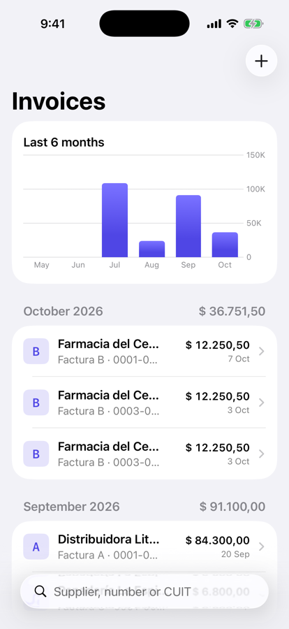
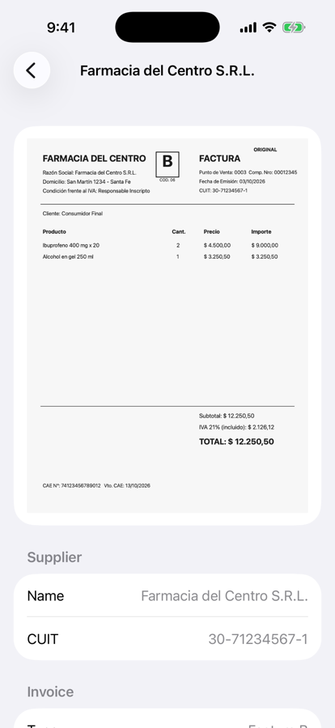

# InvoiceLens

A privacy-first iOS app that turns photos of Argentine invoices (*facturas*) into structured records, **entirely on-device**. It combines Vision OCR, Apple's on-device language model (Foundation Models) with guided generation, and a rule-based fallback. A human review step comes before anything is saved.

<p>
  
  
</p>

## Features

- **Import** from the photo library, or with the document camera (VisionKit) on a device. The camera detects page edges and corrects perspective.
- **On-device OCR** with Vision (Spanish and English), followed by cleanup of common OCR artifacts (`12.250, 50` → `12.250,50`).
- **AI extraction** with Apple Intelligence: the model returns a typed Swift struct through `@Generable`, so there is no JSON parsing.
- **Rule-based fallback** for devices without Apple Intelligence. It also fills fields the model missed and replaces a hallucinated CUIT. It understands:
  - CUIT tax IDs, validated with the mod-11 check digit
  - Factura A / B / C, including the standalone letter box
  - point of sale and invoice number (`0003-00012345`)
  - issue date, *TOTAL* (not *SUBTOTAL*) and IVA, with local number formats
- **Review before saving.** Every field can be edited, an invalid CUIT shows a warning, and the recognized text can be inspected.
- **Monthly overview.** Invoices are grouped by month with totals, a six-month spending chart (Swift Charts) and search by supplier, number or CUIT.

No data leaves the device.

## Tech stack

Swift 6 (strict concurrency) · SwiftUI · SwiftData · Foundation Models · Vision · VisionKit · Swift Charts · Swift Regex · Observation · Swift Testing · XcodeGen

Requires iOS 26 or later. AI extraction requires an Apple Intelligence–capable device with Apple Intelligence turned on. Otherwise the rule-based extractor is used.

## How it works

```
Photo / scan
  → ImageCompressor            downscale to 2000 px JPEG
  → TextRecognizer             Vision OCR + normalization
  → InvoiceExtractionService
       ├─ FoundationModelsInvoiceExtractor   (if available)
       │     .fillingGaps(from: rules)
       └─ RuleBasedInvoiceExtractor          (fallback)
  → InvoiceReviewView          user confirms or corrects
  → SwiftData Invoice          image kept in external storage
```

`InvoiceDraft` is a plain value type passed between the extractors and the review screen. Only confirmed data becomes a persisted `Invoice`. Amounts are always `Decimal`, never `Double`.

### Project structure

```
InvoiceLens/
├── project.yml                  # XcodeGen spec
├── InvoiceLens/
│   ├── App/
│   ├── Models/                  # Invoice (@Model), InvoiceDraft, CUIT
│   ├── Extraction/              # OCR, amount parsing, rule-based and model extractors
│   ├── Features/
│   │   ├── Import/              # InvoiceImporter (@Observable pipeline), document camera
│   │   ├── InvoiceList/         # List, rows, spending chart
│   │   ├── Review/
│   │   └── Detail/
│   └── Preview/                 # Sample data
├── InvoiceLensTests/            # Extraction and OCR tests
├── scripts/                     # Sample invoice generator
└── docs/
```

## Running

```bash
brew install xcodegen
xcodegen generate
open InvoiceLens.xcodeproj
```

To try it in the simulator, add the sample invoice to the photo library, then use **+ → Choose Photo**:

```bash
xcrun simctl addmedia booted docs/sample-invoice.jpg
```

Add the `-seed-sample-data` launch argument for demo invoices. Run the tests with ⌘U.
